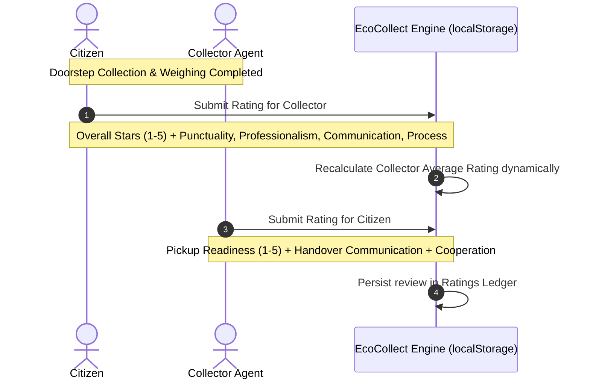

# EcoCollect — Smart Metropolitan E-Waste Collection Platform

[](https://apollo-07.github.io/EcoCollect/)
[](https://github.com/apollo-07/EcoCollect)

🌐 **Public Live URL:** [https://apollo-07.github.io/EcoCollect/](https://apollo-07.github.io/EcoCollect/)


**EcoCollect** is a modern, responsive web application engineered to organize, streamline, and optimize electronic waste (e-waste) collection in metropolitan cities. The platform seamlessly bridges citizens seeking to dispose of obsolete electronics with certified collection agents and R2/ISO-certified recycling processing facilities.

Built primarily with **HTML5, CSS3, Vanilla JavaScript (ES6+), Chart.js, Leaflet.js, and OpenStreetMap**, EcoCollect delivers a production-grade SaaS experience with full frontend persistence via `localStorage`, dynamic multi-factor collector assignment, simulated live GPS tracking, two-way accountability ratings, circular Eco Points rewards, and an AI-driven e-waste classification prototype.

---

## 1. Project Overview

Metropolitan centers generate thousands of tons of electronic waste annually, with citizens facing significant friction in finding verified disposal routes, lack of transparent doorstep pickup, and no structured incentives. EcoCollect solves this through an end-to-end digital lifecycle:


---

## 2. Key Features

### A. Citizen / User Portal (`user/`)
* **Personalized Dashboard**: Real-time greeting, total pickups, kilograms diverted, Eco Points balance, and active ongoing request highlight card.
* **4-Step Multi-Step Request Wizard**:
  * **Step 1 — E-Waste Details**: Category dropdown, device model, quantity, weight auto-estimator, condition pills (Working, Partially Working, Not Working, Damaged), image upload dropzone with preview.
  * **Step 2 — Location Picker**: Street address, city, locality, postal pincode, simulated GPS acquisition, and an interactive **Leaflet map pin picker**.
  * **Step 3 — Schedule**: Date selector with 4 metropolitan delivery windows (Morning, Afternoon, Evening, Late Evening) and special gate/building instructions.
  * **Step 4 — Review & Confirmation**: Breakdown of items, potential Eco Points calculation, unique ID generation (`EC-2026-XXXXXX`), and instant smart collector assignment.
* **Live Route Tracking (`user/tracking.html`)**:
  * 7-stage visual timeline: `REQUESTED` &rarr; `ASSIGNED` &rarr; `ACCEPTED` &rarr; `ON_THE_WAY` &rarr; `ARRIVED` &rarr; `COLLECTED` &rarr; `COMPLETED`.
  * OpenStreetMap interactive map displaying the citizen's doorstep, collector EV van, and destination recycling hub with a dotted route.
  * **Interactive Simulation Control Panel**: Run real-time vehicle driving animation along coordinates and advance lifecycle stages.
* **Multi-Criteria Rating System (`user/rating.html`)**: Overall 5-star rating, individual scores (Punctuality, Professionalism, Communication, Collection process), and written review.
* **Eco Points & Rewards Store (`user/rewards.html`)**: Real-time carbon offset metrics ($1\text{ kg e-waste} \approx 1.44\text{ kg CO}_2\text{ avoided}$), toxics diverted, and instant voucher redemption (Groceries, Sustainable Apparel, Merchandise, Tree Planting) with promo code generation.
* **User Profile (`user/profile.html`)**: Manage default address and download verified eco-citizen credentials.

### B. Collector Agent Console (`collector/`)
* **Availability Switcher**: Live toggle between `AVAILABLE`, `BUSY`, and `OFFLINE`.
* **Fleet Performance Metrics**: Active tasks count, completed deliveries, total collected weight (kg), average rating, and calculated earnings/incentives.
* **Route Queue**: Manage assigned pickups and claim unassigned citizen requests in the collector's metropolitan zone.
* **In-Field Pickup Workflow (`collector/pickup.html`)**: Turn-by-turn navigation map, customer contact shortcuts, digital scale reading verification, photo proof logging, and completion.
* **Two-Way Rating**: Collector rates citizen on *Pickup Readiness*, *Communication*, and *Cooperation*.

### C. Administrator Command Center (`admin/`)
* **High-Level KPI Cards**: Total users, total collectors, total requests, completed pickups, total weight collected (kg), and average platform rating.
* **Chart.js Visualizations (`admin/analytics.html`)**:
  1. **Monthly E-Waste Collection (kg)** — Line chart with smooth spline interpolation.
  2. **E-Waste Categories Distribution** — Doughnut chart covering laptops, mobiles, TVs, batteries, printers, monitors, and appliances.
  3. **Pickup Requests Lifecycle Breakdown** — Bar chart comparing Requested, Assigned, Completed, and Cancelled volumes.
  4. **Collector Fleet Performance & Ratings** — Dual-axis chart comparing completed trips and 5-star ratings.
  5. **City Zone Collection Volume** — Multi-colored bar chart comparing North, South, East, West, and Central zones.
* **Citizen Management (`admin/users.html`)**: Search, filter by zone, inspect historical recycling volume, and review citizen engagement.
* **Collector Fleet Oversight (`admin/collectors.html`)**: Monitor availability, inspect vehicle payloads, and manually override statuses or zones.
* **Dispatch Console (`admin/requests.html`)**: Multi-criteria filters (Status, Category, Zone, Search) and manual collector assignment overrides.
* **Metropolitan GIS Map & Recycling Hubs (`admin/recycling-centers.html`)**: City-wide OpenStreetMap visualization featuring 10 certified recycling facilities, 10 EV fleet collectors, 50 citizen pickup markers, and 3 high-demand hotspot clusters.

### D. AI E-Waste Classification Prototype (`js/ai-classification.js`)
* Analyzes uploaded electronics imagery with a simulated computer vision pipeline (`EcoCollect-VisionNet-v1.4`).
* Outputs detected device model, category classification, detected condition, confidence rating (e.g., $96.4\%$), recommended lifecycle action, potential hazardous materials (Lithium-ion cells, Mercury lamps, Lead solder), and estimated weight.
* Provides a 1-click **"Auto-fill into Request Form"** button.

---

## 3. Technology Stack

* **Frontend Structure**: Semantic HTML5
* **Styling & Layout**: Custom CSS3 (CSS Variables, Flexbox, CSS Grid, custom utility classes, animations, skeleton loading, toasts, modals)
* **Scripting**: Modular Vanilla JavaScript (ES6+, strict separation of storage, auth, domain, and UI logic)
* **Data Visualizations**: [Chart.js](https://www.chartjs.org/) (CDN)
* **Geographical Mapping**: [Leaflet.js](https://leafletjs.com/) with [OpenStreetMap](https://www.openstreetmap.org/) (CDN)
* **Typography & Icons**: Inter Font & Font Awesome 6 (CDN)
* **Persistence Layer**: Browser `localStorage` with unified CRUD abstractions (`storage.js`)

> **Architectural Constraint:** Zero frontend frameworks (no React, Angular, Vue, or build-step dependencies). Cleanly structured for seamless backend adoption (Node.js/Express, Python/FastAPI, PostgreSQL/MongoDB).

---

## 4. Folder Structure

```
EcoCollect/
│
├── index.html                     # Landing Page (Hero, Lifecycle chain, Categories, Testimonials)
├── login.html                     # Unified Login with 1-click Demo credentials
├── register.html                  # Citizen & Collector registration
│
├── user/                          # Citizen / Household Portal
│   ├── dashboard.html             # Overview, active pickup card, recent requests
│   ├── request.html               # 4-Step multi-step request wizard & AI classifier
│   ├── requests.html              # Filterable history of all user requests
│   ├── tracking.html              # Live OpenStreetMap route tracking & simulation
│   ├── rating.html                # Multi-criteria 5-star rating & review
│   ├── rewards.html               # Eco points, impact metrics & coupon shop
│   └── profile.html               # User details, address & verified eco-badge
│
├── collector/                     # Collection Fleet Agent Portal
│   ├── dashboard.html             # Status switcher, earnings & assigned queue
│   ├── requests.html              # Route queue & zone requests claim board
│   ├── pickup.html                # In-field navigation, digital weighing & customer rating
│   └── profile.html               # Vehicle specs, operating zone & ratings
│
├── admin/                         # Municipal Administrator Console
│   ├── dashboard.html             # City overview, metrics cards, summary charts & feed
│   ├── users.html                 # Citizen directory & recycling inspector
│   ├── collectors.html            # Fleet management, status override & zones
│   ├── requests.html              # City-wide requests table with dispatch override
│   ├── analytics.html             # 5 deep-dive Chart.js analytics visualizations
│   └── recycling-centers.html     # Full metropolitan Leaflet map & certified hubs
│
├── css/                           # Modular CSS Architecture
│   ├── style.css                  # Design tokens, buttons, toasts, modals, badges
│   ├── auth.css                   # Authentication cards & demo role pills
│   ├── dashboard.css              # App shell, headers, sidebars, stats grids
│   ├── forms.css                  # Multi-step wizard, dropzone, AI card, rating stars
│   ├── tables.css                 # Responsive tables, search filters, pagination
│   └── responsive.css             # Mobile off-canvas drawers & responsive breakpoints
│
├── js/                            # Decoupled Domain JavaScript Modules
│   ├── storage.js                 # Central localStorage CRUD & 120+ seed records
│   ├── auth.js                    # Session management, page guards & demo switcher
│   ├── app.js                     # Global shell, notifications drawer, toast system
│   ├── user.js                    # Citizen stats, active pickup logic & table filters
│   ├── collector.js               # Availability toggle, weighing & two-way ratings
│   ├── admin.js                   # Municipal KPIs, user/collector/request management
│   ├── request.js                 # 4-Step wizard, Leaflet picker & smart dispatch
│   ├── tracking.js                # Timeline progress, Leaflet vehicle route animation
│   ├── rating.js                  # Multi-criteria scoring & dynamic average recalculation
│   ├── rewards.js                 # Eco Points ledger, carbon formulas & coupon redemption
│   ├── map.js                     # Full city map, layer toggles, recycling directory
│   ├── analytics.js               # 5 Chart.js dynamic visualizers
│   └── ai-classification.js       # Mock AI vision classifier with hazard detection
│
├── assets/                        # Static Assets
│   ├── images/
│   └── icons/
│
└── README.md                      # Comprehensive Technical Documentation
```

---

## 5. How to Run the Project

EcoCollect is a standard web application and does not require any build tools, compilers, or package managers.

### Option 1: Direct File Opening
Double-click `index.html` in any modern web browser (Google Chrome, Mozilla Firefox, Microsoft Edge, Safari).

### Option 2: Local HTTP Server (Recommended)
Running through a local web server ensures full support for local storage events and map tiles:

Using Python 3:
```bash
# Navigate to the project root
cd EcoCollect

# Start lightweight HTTP server
python -m http.server 8000
```
Then navigate to: `http://localhost:8000`

Using Node.js (`npx serve` or `http-server`):
```bash
npx serve .
```

---

## 6. Demo Accounts & Prototype Authentication

For testing and demonstration, EcoCollect includes pre-seeded accounts with 1-click auto-fill buttons on the login page:

| Role | Email Address | Password | Name / Details |
| :--- | :--- | :--- | :--- |
| **Citizen / User** | `user@ecocollect.demo` | `demo123` | Priya Sharma (Indiranagar, 640 Eco Points) |
| **Collector Agent** | `collector@ecocollect.demo` | `demo123` | Rajesh Kumar (DL-04-EV-2104, 4.88 ★) |
| **Administrator** | `admin@ecocollect.demo` | `demo123` | Metropolitan Operations HQ Lead |

> **Quick Demo Role Switcher:** When logged in or exploring any dashboard, a top demo banner allows 1-click instantaneous switching between **Citizen View**, **Collector View**, and **Admin Console** without re-logging in.

---

## 7. How the Two-Way Rating System Works

To prevent informal dumping and maintain high service standards, EcoCollect implements a balanced **two-way rating ecosystem**:



### Dynamic Collector Rating Calculation:
Every time a rating is submitted, `recalculateCollectorRating(collectorId)` retrieves all verified ratings for that collector from `STORAGE_KEYS.RATINGS`:

$$\text{Collector Rating} = \frac{\sum_{i=1}^{N} \text{OverallRating}_i}{N}$$

The updated score is saved to `STORAGE_KEYS.COLLECTORS` and dynamically alters the collector's smart dispatch ranking.

---

## 8. How the Smart Collector Assignment Algorithm Works

EcoCollect **does not hardcode collector assignments**. When a citizen confirms a request in `user/request.html`, the system executes the multi-factor scoring algorithm in `js/request.js`:

```javascript
collectorScore = availabilityScore + ratingScore + distanceScore + workloadScore + categoryScore + zoneScore
```

### Factor Breakdown:
1. **Availability Weight ($+35$ / $-50$)**:
   * `AVAILABLE`: $+35\text{ pts}$
   * `BUSY`: $+5\text{ pts}$
   * `OFFLINE`: $-50\text{ pts}$ (effectively excluded)
2. **Rating Weight ($0\text{ to }30\text{ pts}$)**:
   * Agent's dynamic score scaled: $\text{Rating} \times 6$ (a $5.0\text{ star}$ agent receives $30\text{ pts}$).
3. **Distance Penalty via Haversine Formula ($0\text{ to }30\text{ pts}$)**:
   * Great-circle distance between citizen coordinates and collector coordinates:
     $$\text{distanceScore} = \max(0, 30 - (\text{distanceKm} \times 2))$$
4. **Active Workload Penalty ($0\text{ to }20\text{ pts}$)**:
   * Penalizes agents with multiple ongoing trips:
     $$\text{workloadScore} = \max(0, 20 - (\text{activeTasks} \times 5))$$
5. **Waste Category Compatibility ($+20$ / $-30$)**:
   * $+20\text{ pts}$ if the collector's vehicle supports that category (e.g., heavy trucks for refrigerators); $-30\text{ pts}$ if unsupported.
6. **Zone Match Bonus ($+10\text{ pts}$)**:
   * $+10\text{ pts}$ if the agent's primary sector matches the pickup zone (e.g. South Zone).

The collector with the highest composite score is selected, their active workload increments, and estimated arrival time ($\approx \text{distance} \times 3.5 + 8\text{ mins}$) is computed.

---

## 9. How Analytics & Impact Metrics Are Calculated

All dashboard analytics update dynamically from the live `localStorage` state without hardcoded values:

1. **Total E-Waste Diverted (kg)**:
   $$\text{Total Waste} = \sum (\text{actualWeight} \parallel \text{estimatedWeight}) \quad \forall \text{ Completed Requests}$$
2. **CO₂ Greenhouse Gas Avoidance**:
   $$\text{CO}_2\text{ Avoided (kg)} = \text{Total Waste (kg)} \times 1.44$$
   *(Based on EPA WARM standards for electronic remanufacturing versus virgin smelting).*
3. **Toxic Materials Diverted**:
   $$\text{Toxics Diverted (kg)} = \text{Total Waste (kg)} \times 0.08$$
   *(Accounts for lead in cathode rays/solders, cadmium in relays, and mercury backlights).*
4. **Tree Equivalence**:
   $$\text{Trees Equivalent} = \max\left(1, \left\lfloor\frac{\text{Total Waste (kg)}}{15}\right\rfloor\right)$$
5. **Eco Points Allocation**:
   $$\text{Points} = (\text{Weight in kg} \times 10) + \text{Category Bonus}$$
   *(Bonuses: Mobile $= +20$, Laptop $= +50$, TV $= +80$, Battery $= +30$, Refrigerator $= +100$).*

---

